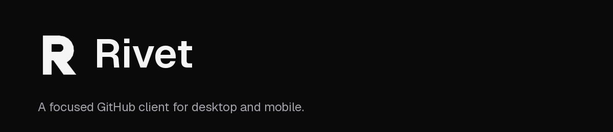
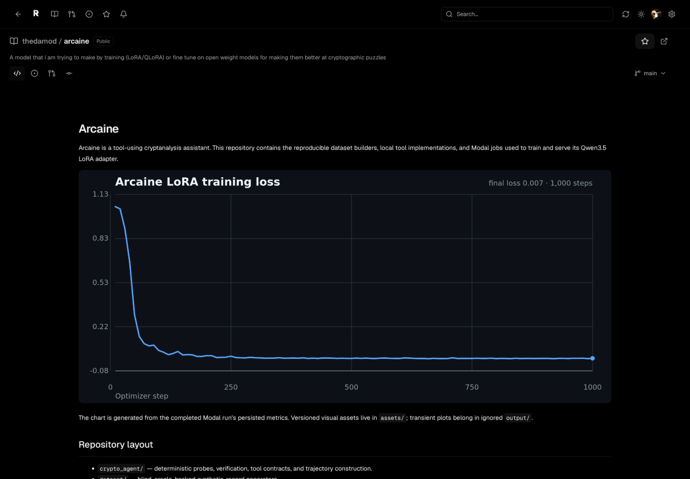
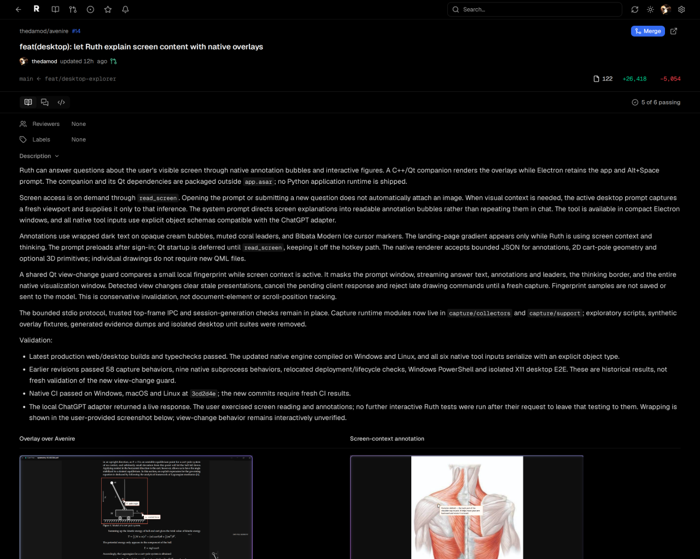
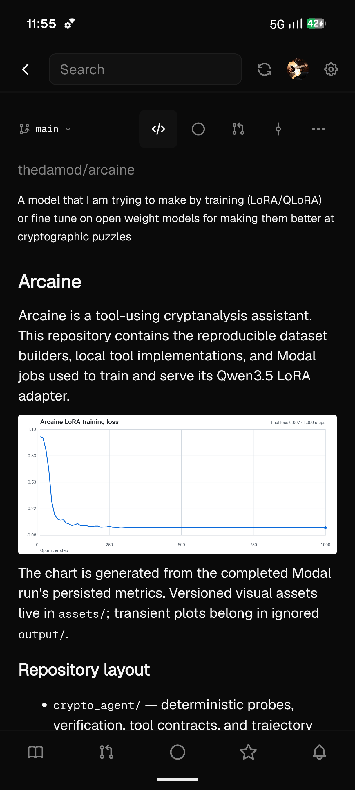
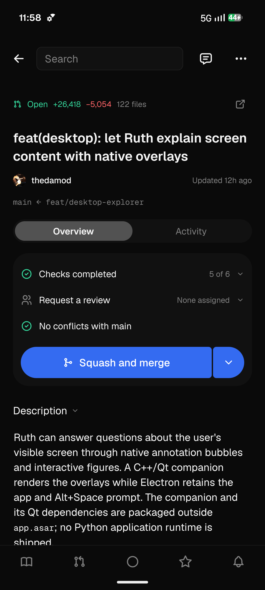

<p align="center">
  
</p>

Rivet brings your repositories, pull requests, issues, and GitHub profiles into a focused desktop and mobile app. Browse a README, expand folders in place, open files beside the tree, and review changes without leaving the app.

The interface is inspired by [T3 Code](https://github.com/pingdotgg/t3code).

## Desktop

Arcaine's repository README.



Avenire's native desktop overlay pull request.



## Mobile

Captured from the native Android app on a USB-connected phone.

<p>
  
  
</p>

## Run locally

Requires Node.js 24 and npm 11.

```sh
git clone https://github.com/thedamod/rivet.git
cd rivet
npm install
```

```sh
npm run desktop   # Desktop app
npm run mobile    # Mobile app
```

Sign in with GitHub from the app. Rivet is in active development.
